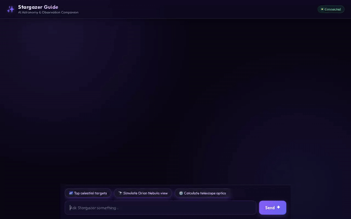

# 🌌 Stargazer & Cosmic Guide

An AI-powered conversational assistant for amateur astronomers and stargazers to plan observation sessions, query deep-space object catalogs, check live sky conditions, calculate optical telescope metrics, and generate astrophotography concepts.



---

## 🚀 Capabilities & Implemented Features

This project is built with the **Google Agent Development Kit (ADK)** and leverages Google Cloud services alongside specialized astronomical APIs:

### 🧠 Google Cloud Services & Framework Integration

* **Vertex AI Memory Bank**: Uses `PreloadMemoryTool` and post-turn callbacks (`add_session_to_memory`) to remember user preferences, observing locations (latitude/longitude, Bortle dark-sky scale), telescope gear (aperture, focal length), and observation logs across sessions.
* **Google Cloud Firestore**: Provides a persistent document database storing a catalog of celestial objects (`search_celestial_objects`, `get_celestial_object_details`, and `add_or_update_celestial_object`).
* **Google Cloud Storage (GCS)**: Stores AI-generated deep-space astrophotography images in a public bucket (`stargazer-cosmic-guide-...`) and serves public HTTPS image URLs.
* **Vertex AI Image Generation (`gemini-3.1-flash-lite-image`)**: Generates deep-space astrophotography concepts and simulated telescopic views (`generate_astrophotography_image`).
* **A2UI (Agent-to-User Interface)**: Implements `A2uiSchemaManager` (v0.8) and `a2ui_callback` to emit structured UI components (cards, text rows, images) rendered natively in the frontend.
* **Agent Development Kit (ADK 1.1.0) & A2A Protocol**: Fully compliant with ADK runtime patterns and the Agent-to-Agent (A2A) protocol.

### 🔭 Astronomical & Geolocation Tools

* **Live Stargazing Conditions (`get_stargazing_conditions`)**: Fetches real-time cloud cover percentage, atmospheric visibility, temperature, humidity, and calculated stargazing suitability ratings via Open-Meteo.
* **NASA APOD (`get_astronomy_picture_of_the_day`)**: Retrieves NASA's Astronomy Picture of the Day metadata, high-res images, and explanations.
* **NASA Asteroid Tracker (`get_near_earth_asteroids`)**: Queries NASA NeoWs for Near-Earth Objects (asteroids) making close approaches, including relative velocity, miss distance, and hazard flags.
* **ISS Real-Time Tracker (`get_iss_location`)**: Tracks International Space Station position coordinates, altitude, velocity, and orbital visibility.
* **Google Maps Geocoding (`geocode_address`)**: Converts addresses or dark-sky site names into precise latitude and longitude coordinates.
* **Google Places API (`find_nearby_places`)**: Finds nearby parks, campgrounds, and dark-sky observing locations around target coordinates.
* **Optical Physics & Math Engine (`calculate`)**: Computes telescope optics metrics (magnification, focal ratio, light-gathering power, field of view).

### 📋 Feature Implementation Status

| Feature / Tool | Status | Implementation Details |
| :--- | :--- | :--- |
| **Vertex AI Memory Bank** | ✅ Implemented | `PreloadMemoryTool` + `generate_memories_callback` |
| **Firestore Celestial Catalog** | ✅ Implemented | Document reads, query filters, and updates |
| **GCS & Astrophotography Gen** | ✅ Implemented | `gemini-3.1-flash-lite-image` + GCS bucket upload |
| **A2UI Card Renderer** | ✅ Implemented | ADK `after_model_callback` UI generator |
| **Live Sky & Stargazing APIs** | ✅ Implemented | Open-Meteo, NASA APOD, NASA NeoWs, ISS API |
| **Google Maps & Places Tools** | ✅ Implemented | Geocoding API & Google Places Nearby API |
| **Optical Physics Engine** | ✅ Implemented | Safe Python math evaluator in `calculate()` |
| **Code Sandbox Executor** | 🚧 Planned | Basic math evaluator active; sandbox code execution planned |

---

## 🛠️ Project Structure

```text
stargazer-cosmic-guide/
├── app/
│   ├── agent.py               # Root ADK Agent, instruction prompt, tool definitions
│   ├── firestore_tools.py      # Firestore database query & update interface
│   ├── a2ui_utils.py          # A2UI schema manager & callback transformer
│   └── fast_api_app.py        # Backend FastAPI app
├── frontend/                  # Web chat interface & A2UI renderer
│   ├── main.py                # FastAPI proxy server
│   └── templates/             # Chat UI HTML/CSS/JS templates
├── demo.gif                   # Recorded demonstration video
├── agents-cli-manifest.yaml   # Agents CLI deployment configuration
├── GEMINI.md                  # Development guide & context
└── pyproject.toml             # Python dependencies
```

---

## 🚦 Local Setup & Running Instructions

### Prerequisites

Ensure you have the following installed:
* Python 3.11+
* `uv` package manager (`pip install uv`)
* `agents-cli` (`uv tool install google-agents-cli`)
* Authenticated Google Cloud SDK (`gcloud auth login` and `gcloud auth application-default login`)

### 1. Install Dependencies

From the project directory:

```bash
uv sync
```

### 2. Configure Environment Variables

Create or update your `.env` file with your GCP project settings:

```bash
GOOGLE_CLOUD_PROJECT="<your-gcp-project-id>"
NASA_API_KEY="DEMO_KEY"  # Or your NASA API Key
GOOGLE_MAPS_API_KEY="<your-google-maps-api-key>"
```

### 3. Launch the Backend Agent Server

Start the agent server locally using `agents-cli`:

```bash
agents-cli playground
```

Or run the ADK server directly:

```bash
uv run adk web
```

### 4. Launch the Custom Frontend Chat UI

In a separate terminal window, start the frontend proxy server:

```bash
cd frontend
python main.py
```

Open your browser to the local port displayed by the server to interact with the Stargazer agent interface.

---

## 🧪 Testing & Evaluation

Run unit and integration tests:

```bash
uv run pytest tests/unit tests/integration
```

Run quality evaluation using `agents-cli`:

```bash
agents-cli eval
```

---

## ☁️ Deployment

Deploy the agent to Google Cloud Agent Runtime:

```bash
gcloud config set project <your-project-id>
agents-cli deploy
```
